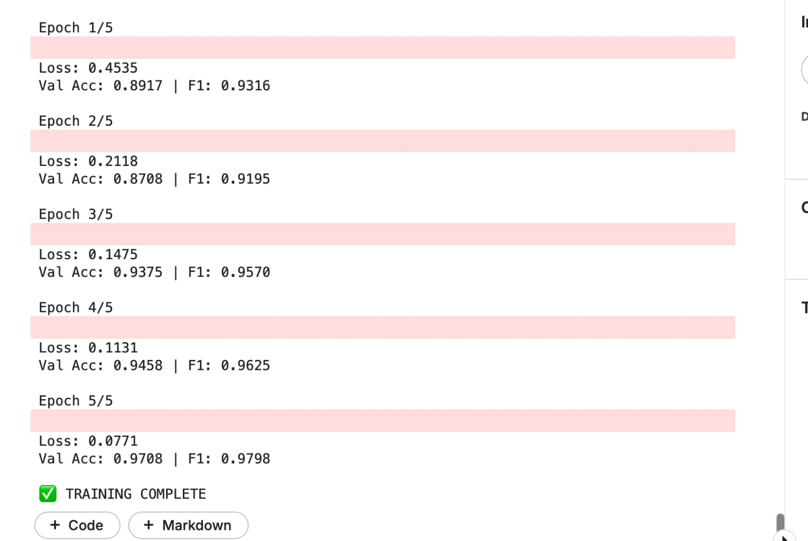

# Video Forgery Detection with 97% Accuracy

Cross-Modal Deepfake Detection using Video + Audio.

## Results
- Validation Accuracy: 97.08%
- F1 Score: 97.98%
- Dataset: LAV-DF (Localized Audio Visual Deepfake Dataset)

## How it works
1. Video se 16 frames nikalte hain - ResNet18 se features
2. Audio se Mel-Spectrogram banate hain - ResNet18 se features
3. Dono ko combine karke Fake / Real predict karte hain

## How to Run
pip install -r requirements.txt
python main.py
